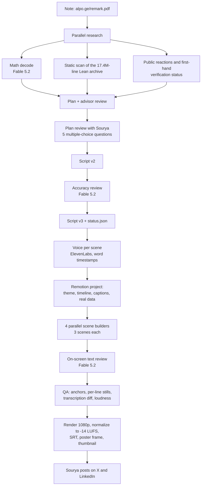

# How the Riemann Hypothesis explainer was made

A 5-minute narrated, animated explainer of the claimed proof of the Riemann Hypothesis that Levent Alpöge posted on November 20, 2026. It covers what RH says, the idea his note describes (a chain of "theta lifts" standing in for derivatives of whole numbers), what had been machine-checked, and what was still missing.

- **Watch it:** the X thread, https://x.com/curious_queue/status/2124124652192862458
- **Full-quality files:** the GitHub release, https://github.com/ma08/botfiles/releases/tag/rh-explainer-2026-11-20 (1080p MP4 with and without burned-in captions, SRT, thumbnail)
- **Reuse the workflow:** the `explainer-video` skill in this repo, `claude/skills/explainer-video/` (same skill under `codex/skills/explainer-video/`)

Everything here was produced by AI agents directed by Sourya Kakarla: research, script, voice, animation code, QA and this writeup. Sourya made the decisions listed in `artifacts/decisions.md` and posted the result. The narration is an AI voice (ElevenLabs), and the end card says so.

## The pipeline



## Timeline (all times PST)

| When | What happened |
|---|---|
| Nov 20, 11:10am | Note read. Research fanned out in parallel: a math decode by Fable 5.2, a streaming static scan of the Lean archive (nothing compiled or executed), public reactions, and voice samples from three TTS providers. |
| ~12:50pm | Plan drafted, then reviewed by an advisor model. It sent the agent back for first-hand status: the Lean Zulip thread and Andrew Sutherland's verification page. |
| ~1:05pm | Three style frames rendered from the same scene so the look question had pictures. |
| 1:20pm | Plan review with Sourya: framing, depth, voice, look, review cadence. Plan accepted. |
| ~1:35 to 2:00pm | Script v2 (12 scenes, about 690 words). Fable reviewed every line against the note, the Lean reading and the status snapshot. Fixes applied as v3. |
| ~2:25pm | Remotion project scaffolded. Real data generated (primes, li(x), the first 100 zeta zeros with mpmath, explicit-formula partial sums, a curve over F₃₁). All 12 scenes voiced with word timestamps: 5:06. |
| ~2:30pm | Four scene-builder agents started in parallel, three scenes each, each rendering and inspecting its own stills. Fable wrote the companion deep dive. |
| 2:51pm | The session ended mid-build. All 12 scenes had real code by then. |
| 6:51pm | Resumed. Verification status re-read first-hand: six or more independent proof checkers now accepted the proof. Status lines, scene 11 and the thread draft updated. |
| ~7:00pm | Re-voiced, word anchors asserted, end-card timing fixed, honesty tags enlarged. Half-scale test render. |
| ~7:20pm | Fable reviewed all on-screen text against stills: 3 must-fix, 13 should-fix. All applied. |
| ~7:45pm | Advisor's final review: "the first" became "one of the first", "separately written" became "independent", poster frame, music ending. |
| ~8:05pm | Final cut: 5:08, 1080p, -14 LUFS. |
| Nov 21, ~4:56am | Sourya posted the thread on X with his own opener. |
| ~5:05 to 5:33am | LinkedIn post copy and thumbnail. |
| Nov 22 | This writeup and the `explainer-video` skill. |

## Who did what

- **Sourya Kakarla:** asked for it, made every decision in `artifacts/decisions.md`, approved the name pronunciations, edited and posted the thread.
- **Claude Opus 5.5 in Claude Code:** orchestrated the work. It wrote the plan, the script drafts, the Remotion scaffolding (theme, timeline and caption components, data scripts, TTS and QA scripts), integrated everything and ran QA, rendering and packaging.
- **Claude Fable 5.2 (subagents):** the math decode, the reconciliation of that decode with the Lean code, the deep dive, and the two accuracy reviews (script, then on-screen text).
- **Four scene-builder subagents:** wrote the 12 scene components, about 5,900 lines of React/TypeScript, against a shared brief (`project/BRIEF.md`). Each owned its own files and checked its own stills.
- **An advisor reviewer model:** reviewed the plan before work started and the deliverable before it was called done. Most of the late fixes came from those two reviews.
- **ElevenLabs:** narration ("George", eleven_v3, a premade voice) with character timestamps; the ambient music bed (ElevenLabs Music).
- **OpenAI gpt-4o-transcribe:** transcribed every scene and the final mix to diff against the script.
- **Remotion 4.0.545:** rendered React components frame by frame to MP4. ffmpeg handled tempo, loudness and encoding.

## The accuracy loop

The rule was that the narrator never says "proved" in its own voice, and every claim traces to the note, to Lean code read verbatim, to Sutherland's status page, or to standard background. The reviews caught real problems:

- "But nobody could prove it for every one" is past tense, which implies someone now has. It became "checking trillions isn't proving it for every one."
- "Claude suggested about the square root of X rungs" was stated in the narrator's voice. It became "he says Claude suggested...", and "primes up to X" became "a sum over primes up to X".
- The toy proof (qN = M^k + R) was presented as a new proof of Weil's theorem. It became "his new, unpublished proof... he says", tagged on screen as the author's account and reported absent from the released Lean.
- An on-screen headline read "41 days", which overreads a Claude-compiled timeline. It became "Oct 6 → Nov 16 · the note's timeline".
- A data bug: the last-digit chart dropped the prime 3 (a `primes > 5` filter), so "ends in 3" read 19,664 instead of 19,665. Regenerated.
- "The first major proof a machine checked before anyone could explain it" became "one of the first". The forum mentioned an earlier formalized-before-written result.
- "Six separately written checkers" became "six independent proof checkers", matching what the sources say.
- Kickers like "What nobody has yet" and "who did what" became "What's still missing" and "the note's timeline", since only the note's own account of who did what is available.

Review outputs are in `artifacts/script-v2-review.md` and `artifacts/onscreen-review.md`.

## Handling a live, moving status

The proof was being checked while the video was made. Status was read first-hand twice (11:45am and about 6:55pm PST). All status text lives in one file, `project/script/status.json`. Scene 11 and the end card render from it with an "as of" stamp. Changing a status line re-voices only that scene. The snapshots are in `artifacts/verification-status-snapshot-*.md`.

## QA, in the order it ran

- **Word anchors:** every visual beat is keyed to a spoken word (`wordFrame(scene, 'zeta')`), never to a hard-coded frame. A script asserts all 215 anchors resolve after each re-voice, because a missing word silently returns frame 0.
- **Stills:** one at the midpoint of every narration line (59), plus contact sheets, compared against the caption at that moment. That's how the end card covering the third takeaway was found.
- **Audio:** transcription diffs against the script for every scene and for the final mix. The only differences were number formatting and name spellings.
- **Loudness and speaking rate:** voice clips within 0.8 LU of each other, final mix normalized two-pass to -14 LUFS, -1.4 dBFS true peak. Speaking rate checked in characters per second, since words per second is skewed by spoken numbers.
- **Edges:** frames across every scene boundary, a poster frame that isn't black (X can use frame 0 as the thumbnail), and music that resolves under the end card.

## Pitfalls worth knowing

- Including the TTS seed in the cache key silently re-voiced every scene. Put anything that changes audio in the key deliberately.
- Two data files named `timeline.json` collided (narration timings and the note's dated items) and broke the build in a confusing way.
- `wordFrame` falls back to frame 0 when a word is missing. Assert, or fall back to a position within the line.
- DM Mono renders "½" as a smudge at small sizes; write "1/2". Cormorant Garamond's default old-style numerals turn "1" into something like "ɪ" in formulas; turn on lining numerals.
- In an SVG mask, black hides. A "fade" gradient built from black stops made a whole chart invisible.
- The generated music had 7 seconds of silence at the end. Trim before fitting it to the video.
- Long claims age fast. "Claimed. Not yet verified." was stale within hours. Keep status in data and stamp it.
- Downloading the 239 MB Lean archive filled the laptop's disk once. Stream big archives instead of extracting them.
- Agents stopped mid-session left headless Chrome processes running. Check for orphans after interruptions.

## What's in this folder

```
README.md                 this writeup
artifacts/
  decisions.md            every choice Sourya made
  script-v2.json          first full script
  script-v2-review.md     Fable's line-by-line accuracy review
  script-final.json       the narrated script (pronunciation respellings included)
  onscreen-review.md      review of all on-screen text against stills
  research-math-decode.md, research-reconcile-lean-decode.md
  research-lean-archive.md, research-lean-main-statements.lean
  verification-status-snapshot-*.md
  rh-deep-dive.md         the companion explainer for a technical reader
  x-thread-as-posted.md, linkedin-post.txt
  linkedin-thumbnail.jpg, qa-one-frame-per-scene.jpg, contact-sheet-*.jpg
project/                  the Remotion project as rendered
  BRIEF.md                the brief given to the scene-builder agents
  script/                 script.json, status.json, TTS cache keys
  scripts/                tts.py, check_audio.py, check_needles.py, make_srt.py,
                          loudnorm.py, line_stills.mjs, contact.mjs, gen_data.py,
                          fetch_note_page.sh
  src/                    theme, timeline/caption components, 12 scenes, thumbnail
  public/audio/           the 12 narration clips (64 kbps mono) + word alignments
  public/music/bed.mp3    the ambient bed (64 kbps)
  public/data/            the real data behind every chart
```

The committed audio is reduced to 64 kbps to keep the repo small. The release has the full-quality video.

## Re-rendering it

```bash
cd project
npm install
bash scripts/fetch_note_page.sh      # scene 1 shows page 1 of the note; it isn't committed
python3 scripts/tts.py               # rebuilds the timeline from the committed audio; needs ELEVENLABS_API_KEY only if you change the script text
npx remotion render src/index.ts RHExplainerCaptioned out/rh-explainer-captioned-raw.mp4
python3 scripts/loudnorm.py out/rh-explainer-captioned-raw.mp4 out/rh-explainer-captioned.mp4
python3 scripts/make_srt.py
```

`npx remotion studio src/index.ts` opens the interactive preview, with every scene as its own composition. `python3 scripts/check_needles.py` checks the word anchors. `python3 scripts/check_audio.py` (needs `OPENAI_API_KEY`) runs the transcription diff.

## Sources, credits and licences

- **The claim:** Levent Alpöge, "remark" (November 20, 2026), https://alpo.ge/remark.pdf. The Lean archive is linked from the note. Quotes in the video are short and attributed; the page image is fetched by script, not redistributed.
- **Verification status:** Andrew Sutherland (MIT), https://math.mit.edu/~drew/grh/, and the Lean community Zulip thread "Discussion: Alpöge Proves the Riemann Hypothesis" in #general at https://leanprover.zulipchat.com/. Read on Nov 20 (11:45am and about 6:55pm PST) and re-checked on Nov 21.
- **The formal statement** is Mathlib's own `RiemannHypothesis`, https://github.com/leanprover-community/mathlib4.
- **Numbers on screen:** π(10¹²) = 37,607,912,018 and li(10¹²) − π(10¹²) = 38,263 (standard published values). The first 100 zeta zeros and every chart were computed with mpmath and numpy (`project/scripts/gen_data.py`).
- **Rendering:** Remotion, https://www.remotion.dev. Check its licence before reusing commercially: https://www.remotion.dev/license.
- **Voice and music:** ElevenLabs (AI-generated; disclosed on the end card).
- **Fonts:** Cormorant Garamond, DM Sans and DM Mono from Google Fonts, loaded through `@remotion/google-fonts`.
- **Code and writeup:** written by AI agents under Sourya Kakarla's direction. MIT licensed with the rest of this repo, except third-party material cited above.
